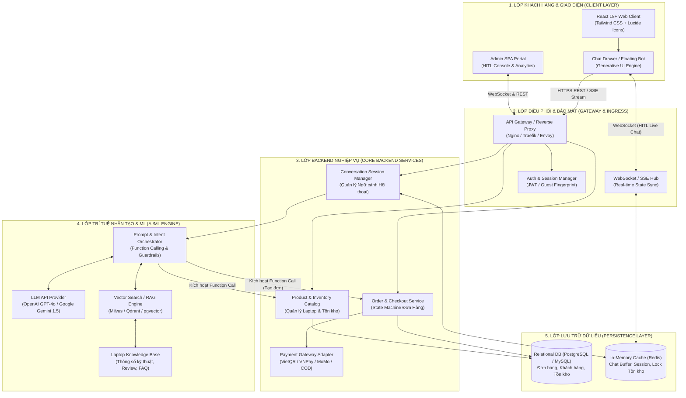
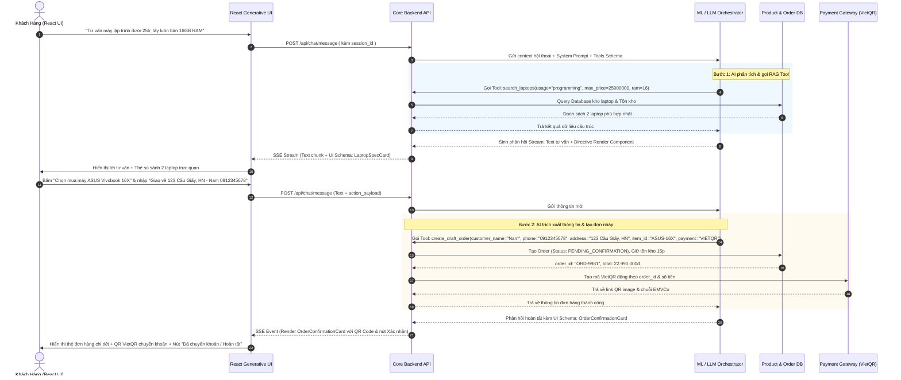

# TỔNG QUAN KIẾN TRÚC HỆ THỐNG LAPBOT
## Hệ Thống Thương Mại Điện Tử Chat-to-Order Bán Laptop Tích Hợp Machine Learning & Generative UI

---

## 1. GIỚI THIỆU DỰ ÁN

### 1.1. Bối cảnh & Tầm nhìn
Trong mô hình thương mại điện tử truyền thống bán Laptop, khách hàng thường gặp rào cản lớn về mặt kỹ thuật khi phải tự mình lựa chọn giữa hàng trăm thông số phức tạp (CPU thế hệ nào, dung lượng RAM, chuẩn bus, card đồ họa rời hay tích hợp, độ sáng/tần số quét màn hình, khả năng nâng cấp...). Quá trình từ khi có nhu cầu đến khi hoàn tất đơn hàng qua giỏ hàng truyền thống (Cart & Checkout) thường mất nhiều thời gian và tỷ lệ rơi rụng (drop-off rate) cao.

**LapBot** ra đời nhằm giải quyết triệt để bài toán này bằng cách biến **hội thoại tự nhiên** thành **đơn hàng cụ thể (Chat-to-Order)**:
- Người dùng chỉ cần diễn đạt nhu cầu bằng ngôn ngữ tự nhiên: *"Tìm cho mình laptop lập trình và chơi game nhẹ tầm 20 triệu, pin trâu chút"*.
- AI Engine (LLM API kết hợp RAG & Function Calling) tự động thấu hiểu ý định, truy vấn kho dữ liệu laptop, so sánh thông số, tư vấn giải pháp tối ưu.
- AI không chỉ trả lời văn bản thô mà trực tiếp phản hồi các **Interactive Generative UI Components** (Thẻ sản phẩm có nút tùy biến cấu hình, Thẻ tóm tắt đơn hàng, Biểu mẫu xác nhận địa chỉ inline).
- Khách hàng có thể chốt đơn và thanh toán (COD hoặc VietQR) ngay trong luồng chat chỉ trong vài thao tác chạm.

### 1.2. Mục tiêu kỹ thuật cốt lõi
1. **Chuyển đổi hội thoại thành cấu trúc dữ liệu đơn hàng (Conversational Intent to Structured Order)** với độ chính xác > 95%.
2. **Generative UI / Micro-frontends in Chat**: Giao diện React hiển thị linh hoạt các widget tương tác dựa trên schema dữ liệu trả về từ AI.
3. **Độ trễ thấp & Trải nghiệm mượt mà**: Hỗ trợ Server-Sent Events (SSE) để stream câu trả lời kèm render widget tức thời.
4. **Cơ chế Human-in-the-Loop (HITL)**: Cho phép nhân viên CSKH/Admin giám sát và can thiệp tức thì khi AI cần hỗ trợ hoặc khi khách hàng yêu cầu.

---

## 2. KIẾN TRÚC TỔNG THỂ HỆ THỐNG (SYSTEM ARCHITECTURE)

Hệ thống LapBot được xây dựng theo mô hình **Phân lớp hướng dịch vụ (Service-Oriented Architecture)**, kết hợp giữa **React Client**, **Application Backend API**, **ML/LLM Gateway**, **Vector Database (RAG)** và **Real-time Event Broker**.

---

## 3. CÁC THÀNH PHẦN KỸ THUẬT & TRÁCH NHIỆM

### 3.1. Phía Frontend Khách hàng (React Client)
- **Quản lý phiên hội thoại**: Lưu trữ lịch sử chat cục bộ kết hợp đồng bộ máy chủ qua `session_id`.
- **Generative UI Parser**: Trình phân tích cú pháp chuỗi streaming từ AI, phát hiện các thẻ đặc tả widget (`tool_call` hoặc JSON block định dạng `ui_widget`) và render các component tương tác tương ứng.
- **Micro-State Synchronizer**: Cập nhật trạng thái giỏ hàng, thông tin giao hàng và đơn hàng xem trước (Order Preview) theo thời gian thực mà không làm gián đoạn dòng chat.

### 3.2. Phía Backend Điều phối (Application Core)
- **Quản lý vòng đời đơn hàng (Order State Machine)**: Quản lý các trạng thái từ `DRAFT` (Đang thảo luận trong chat) -> `PENDING_CONFIRMATION` (Chờ khách bấm xác nhận) -> `CONFIRMED` -> `PAID/PROCESSING` -> `COMPLETED`.
- **Khóa giữ hàng tạm thời (Soft Inventory Lock)**: Khi đơn hàng được AI tạo ở trạng thái chờ xác nhận, hệ thống giữ chỗ tồn kho trong 15 phút (sử dụng Redis TTL).
- **Điều phối Thanh toán**: Tích hợp module sinh mã QR chuyển khoản VietQR tự động theo cú pháp định danh đơn hàng và số tiền chính xác.

### 3.3. Phía AI / ML Engine (Orchestrator)
- **Phân loại ý định (Intent Classifier)**: Phân biệt các mục đích: Chào hỏi, Hỏi thông số laptop, So sánh laptop, Đàm phán giá/khuyến mãi, Sửa thông tin đơn hàng, và Chốt tạo đơn hàng.
- **RAG (Retrieval-Augmented Generation)**: Chuyển đổi yêu cầu của khách thành vector embedding, tìm kiếm ngữ nghĩa trong cơ sở dữ liệu laptop để lấy thông tin sản phẩm chính xác, tránh hiện tượng ảo giác (hallucination).
- **Function Calling Engine**: Cung cấp bộ công cụ định sẵn cho mô hình LLM:
  - `search_laptops(query, budget_min, budget_max, brand, usage_type)`
  - `get_laptop_detail(laptop_id)`
  - `check_inventory_and_promo(laptop_id, variant_id)`
  - `create_draft_order(customer_info, items, payment_method)`
  - `request_human_agent(reason)`

### 3.4. Phía Admin Quản trị & Giám sát (Admin Portal)
- **Bàn điều khiển Human-in-the-Loop (HITL)**: Hiển thị các phiên chat đang diễn ra, xếp hạng mức độ rủi ro (độ bế tắc của AI, cảm xúc tiêu cực của khách qua sentiment analysis) và cho phép nhân viên ấn "Tiếp quản" (Takeover) để chat trực tiếp với khách.
- **Quản trị Tri thức AI**: Cho phép quản trị viên thêm tài liệu hướng dẫn bán hàng, thông số sản phẩm mới, cập nhật chương trình khuyến mại để tự động sinh vector embedding mới.
- **Phân tích phễu chuyển đổi (Chat-to-Order Conversion Funnel)**: Đo lường tỷ lệ bắt đầu chat, tỷ lệ xem thẻ sản phẩm, tỷ lệ tạo đơn nháp và tỷ lệ thanh toán thành công.

---

## 4. LUỒNG DỮ LIỆU END-TO-END (END-TO-END DATA FLOW)

Biểu đồ tuần tự dưới đây mô tả chu trình toàn vẹn từ khi khách hàng đưa ra yêu cầu bằng lời nói đến khi đơn hàng được ghi nhận và hiển thị mã thanh toán QR.

---

## 5. MA TRẬN PHÂN CHIA TRÁCH NHIỆM BỘ TÀI LIỆU (DOCUMENTATION ROADMAP)

Để đảm bảo toàn bộ hệ thống được đặc tả chi tiết và có thể chuyển giao cho các đội ngũ triển khai độc lập, bộ tài liệu trong thư mục `LapBot/` được phân tách như sau:

| Mã File | Tên Tài Liệu | Mục Đích Thiết Kế | Đối Tượng Sử Dụng |
| :--- | :--- | :--- | :--- |
| **`01`** | **Tài Liệu Nghiệp Vụ (BRD/SRS)** | Định nghĩa toàn bộ quy trình nghiệp vụ Chat-to-Order, phân loại khách hàng, chính sách bán hàng, quy tắc kho và State Machine của đơn hàng. | Product Manager, BA, QA, Tech Lead |
| **`02`** | **Tài Liệu Giao Diện AI Thực Thi** | Đặc tả thiết kế UI/UX theo cơ chế Generative UI, wireframe cấu trúc từng thẻ tương tác trong chat, micro-interactions và hướng dẫn trải nghiệm người dùng. | UI/UX Designer, Frontend Engineer |
| **`03`** | **Tài Liệu Kỹ Thuật AI Phía Frontend** | Kiến trúc mã nguồn React, mô hình quản lý State (Zustand), cơ chế phân giải SSE Stream thành UI component, Event Bus và xử lý sự cố mạng. | Frontend Lead, React Developers |
| **`04`** | **Tài Liệu Kỹ Thuật AI Phía Admin** | Đặc tả hệ thống bàn làm việc Admin, giao diện giám sát phiên chat theo thời gian thực, giao thức can thiệp Human-in-the-loop, quản trị RAG và đo lường Analytics. | Backend/Fullstack Developers, DevOps, CSKH |
| **`05`** | **Thiết Kế API ML & CSDL** | Chuẩn hóa toàn bộ REST/WebSocket API, JSON Schema cho Function Calling của LLM, và lược đồ cơ sở dữ liệu quan hệ (ERD). | Backend Engineer, AI Engineer, DBA |
| **`06`** | **Kịch Bản Chat-to-Order & Prompt System** | Định nghĩa System Prompt, Persona, Guardrails bảo vệ hệ thống, cùng bộ kịch bản chi tiết đa lượt thoại cho mọi trường hợp nghiệp vụ. | AI Prompt Engineer, BA, Domain Expert |

---

## 6. NGUYÊN TẮC BẢO MẬT & ĐẢM BẢO CHẤT LƯỢNG (GUARDRAILS & NON-FUNCTIONAL REQUIREMENTS)

1. **Chống Tiêm Nhiễm Lệnh (Prompt Injection Defense)**: Mọi đầu vào từ người dùng đều phải được kiểm tra qua lớp lọc từ khóa độc hại và ràng buộc thông qua cấu trúc phân tách nghiêm ngặt giữa `System Instruction` và `User Input`.
2. **Ngăn Chặn Ảo Giác Giá & Tồn Kho (Zero Price Hallucination)**: AI tuyệt đối không tự bịa đặt giá cả hoặc tình trạng còn hàng; mọi dữ liệu giá và tồn kho bắt buộc phải được lấy trực tiếp từ database thông qua Function Calling.
3. **Bảo Mật Thông Tin Khách Hàng (PII Protection)**: Số điện thoại, địa chỉ nhận hàng của khách khi truyền vào context model LLM bên thứ ba phải tuân thủ chính sách che giấu dữ liệu (data masking/anonymization) nếu cần thiết theo quy định nội bộ.
4. **Khả Năng Chịu Lỗi (Fault Tolerance & Graceful Degradation)**: Trong trường hợp API của nhà cung cấp LLM bị gián đoạn hoặc vượt ngưỡng hạn ngạch (rate limit), hệ thống tự động fallback về kịch bản rule-based thông minh hoặc chuyển hướng người dùng sang form đặt hàng truyền thống kèm thông báo xin lỗi lịch sự.
