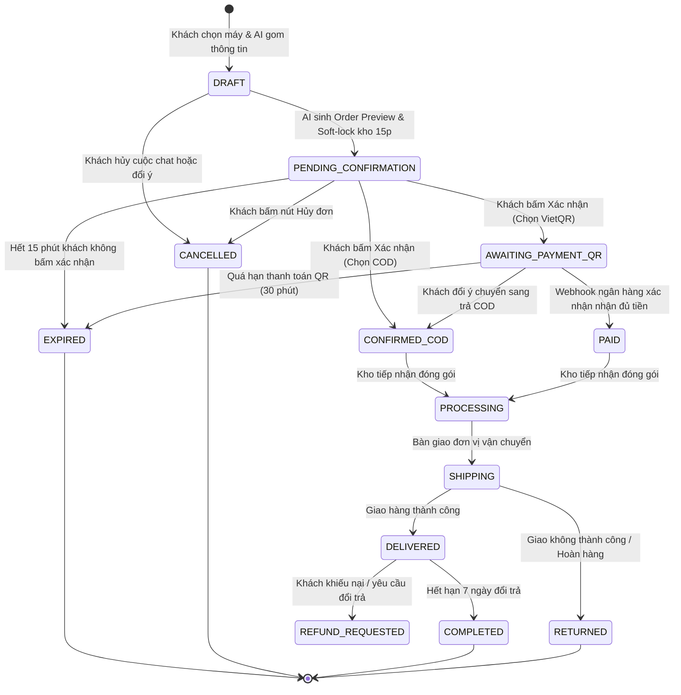

# TÀI LIỆU YÊU CẦU NGHIỆP VỤ (BRD / SRS)
## Hệ Thống Chat-to-Order Bán Laptop - Dự Án LapBot

---

## 1. MỤC TIÊU VÀ PHẠM VI NGHIỆP VỤ

### 1.1. Mục tiêu kinh doanh
1. **Rút ngắn thời gian chốt đơn (Time-to-Purchase)**: Giảm thời gian trung bình từ khi khách hàng tìm kiếm cấu hình laptop đến lúc hoàn tất đặt hàng từ 15 phút (trên web truyền thống) xuống dưới 3 phút qua hội thoại.
2. **Tăng tỷ lệ chuyển đổi (Conversion Rate)**: Nâng cao tỷ lệ chuyển đổi khách truy cập thành khách mua hàng nhờ khả năng tư vấn đúng nhu cầu kỹ thuật và hỗ trợ đặt hàng trực tiếp ngay trong giao diện chat.
3. **Giảm áp lực nhân sự CSKH**: Tự động hóa tới 80% các câu hỏi tư vấn cấu hình, đối chiếu tồn kho và thu thập thông tin đơn hàng; chỉ chuyển 20% các trường hợp đặc biệt sang nhân viên tư vấn.

### 1.2. Phạm vi nghiệp vụ (Scope)
- **Trong phạm vi (In-Scope)**:
  - Tiếp nhận và phân tích nhu cầu laptop (học tập, văn phòng, đồ họa 2D/3D, lập trình, gaming, mỏng nhẹ di động...).
  - Tra cứu cấu hình chi tiết (CPU, RAM, SSD, Card VGA, Màn hình, Khối lượng, Thời lượng pin).
  - So sánh trực quan giữa 2 hoặc 3 mẫu laptop theo tiêu chí người dùng đặt ra.
  - Quản lý giỏ hàng tạm (Cart Session) thông qua hội thoại.
  - Thu thập thông tin giao hàng: Họ tên, Số điện thoại (chuẩn định dạng Việt Nam), Địa chỉ nhận hàng (Tỉnh/Thành, Quận/Huyện, Phường/Xã, Số nhà/Đường), Ghi chú giao hàng.
  - Áp dụng mã giảm giá / khuyến mãi hợp lệ.
  - Khởi tạo đơn hàng với 2 phương thức thanh toán: COD (Tiền mặt khi nhận hàng) và Chuyển khoản VietQR tức thời.
  - Tra cứu trạng thái đơn hàng đã đặt bằng Số điện thoại hoặc Mã đơn hàng.
- **Ngoài phạm vi (Out-of-Scope)**:
  - Cho vay trả góp tài chính phức tạp liên kết trực tiếp với ngân hàng xét duyệt hồ sơ tín dụng (hệ thống chỉ cung cấp thông tin tư vấn và ghi nhận nhu cầu trả góp).
  - Xử lý đổi trả vật lý tại kho (hệ thống chỉ tiếp nhận yêu cầu và tạo phiếu bảo hành/đổi trả).

---

## 2. PHÂN LOẠI ĐỐI TƯỢNG NGƯỜI DÙNG & TÁC NHÂN (ACTORS)

| Tác nhân (Actor) | Mô tả vai trò | Đặc quyền nghiệp vụ |
| :--- | :--- | :--- |
| **Khách vãng lai (Guest User)** | Khách hàng truy cập website nhưng chưa đăng nhập tài khoản. | Được tư vấn, chọn sản phẩm, cung cấp Tên + SĐT + Địa chỉ để chốt đơn. Hệ thống tự động tạo mã khách hàng tạm theo session và SĐT. |
| **Khách thành viên (Registered User)** | Khách hàng đã đăng nhập tài khoản trên hệ thống. | Tự động điền thông tin địa chỉ mặc định, lưu lịch sử đơn hàng vào hồ sơ cá nhân, tích điểm thành viên và hưởng ưu đãi hạng thẻ. |
| **LapBot (AI Assistant)** | Tác nhân AI bán hàng tự động tích hợp LLM & RAG. | Đọc hiểu ngữ cảnh, tra cứu kho dữ liệu laptop, tính toán giá trị đơn hàng, kích hoạt lệnh tạo đơn nháp và gửi thông báo. |
| **Nhân viên CSKH / Sale (Agent)** | Nhân viên tư vấn con người làm việc tại cổng Admin. | Giám sát các phiên chat trực tiếp, tiếp quản cuộc trò chuyện (Takeover) khi AI gặp khó khăn hoặc khách yêu cầu gặp người thật, chỉnh sửa đơn hàng theo thỏa thuận. |
| **Quản trị viên (Admin)** | Quản lý hệ thống toàn diện. | Xem báo cáo doanh thu, tỷ lệ chốt đơn của AI, quản lý danh mục sản phẩm, cấu hình kịch bản RAG và xem audit log. |

---

## 3. QUY TRÌNH NGHIỆP VỤ CHAT-TO-ORDER CHI TIẾT

### 3.1. Sơ đồ luồng nghiệp vụ tổng thể (Business Process Flow)

```mermaid
flowchart TD
    Start([Khách hàng mở khung Chat]) --> AskNeed[Khách nêu nhu cầu / Ngân sách]
    AskNeed --> AIConsult[AI phân tích & Tư vấn cấu hình phù hợp]
    AIConsult --> SuggestCard[AI hiển thị Thẻ Laptop Spec Card]
    
    SuggestCard --> UserAction{Khách phản hồi?}
    UserAction -- "Muốn xem máy khác / Đổi ngân sách" --> AskNeed
    UserAction -- "So sánh 2 máy" --> AISpare[AI so sánh điểm mạnh / yếu] --> SuggestCard
    UserAction -- "Chốt mua máy" --> CollectInfo[AI yêu cầu Thông tin giao hàng]
    
    CollectInfo --> InputInfo[Khách cung cấp: Tên, SĐT, Địa chỉ, PTTT]
    InputInfo --> ValidateInfo{Dữ liệu hợp lệ?<br/>(Regex SĐT, Địa chỉ đầy đủ)}
    
    ValidateInfo -- "Thiếu / Sai" --> PromptCorrection[AI lịch sự yêu cầu bổ sung thông tin] --> InputInfo
    ValidateInfo -- "Hợp lệ" --> CheckStock{Kiểm tra tồn kho thực tế}
    
    CheckStock -- "Hết hàng" --> OutOfStockNotice[AI thông báo hết hàng & gợi ý máy tương đương] --> SuggestCard
    CheckStock -- "Còn hàng" --> CreateDraft[Hệ thống khóa tạm tồn kho 15 phút<br/>Sinh Order Draft]
    
    CreateDraft --> ShowOrderCard[AI hiển thị Thẻ Đơn Hàng Preview<br/>Kèm chi tiết giá & nút Xác Nhận]
    ShowOrderCard --> UserConfirm{Khách bấm xác nhận?}
    
    UserConfirm -- "Muốn sửa thông tin / Hủy" --> EditOrCancel[Điều chỉnh đơn hàng trong chat] --> ShowOrderCard
    UserConfirm -- "Bấm 'Xác Nhận Đặt Hàng'" --> FinalizeOrder[Chuyển trạng thái đơn sang PENDING/CONFIRMED]
    
    FinalizeOrder --> PayMethod{Phương thức thanh toán}
    PayMethod -- "COD (Tiền mặt)" --> NotifySuccess[Thông báo đặt hàng thành công & gửi SMS/Zalo xác nhận]
    PayMethod -- "VietQR" --> GenQR[Hiển thị mã VietQR động có sẵn số tiền & nội dung] --> AwaitPayment[Chờ giao dịch ngân hàng]
    
    NotifySuccess --> End([Kết thúc quy trình])
    AwaitPayment --> End
```

### 3.2. Các giai đoạn nghiệp vụ chi tiết

#### Giai đoạn 1: Khám phá nhu cầu & Tư vấn kỹ thuật (Discovery & Consulting)
1. **Thu thập tiêu chí**: AI lắng nghe các thông tin từ khách:
   - Mục đích sử dụng: Văn phòng, Kế toán, Đồ họa thiết kế (Photoshop, Premiere, AutoCAD), Lập trình (Web, Mobile, Docker), Gaming (Esports, AAA), Doanh nhân mỏng nhẹ.
   - Mức ngân sách mong muốn (Ví dụ: 15-20 triệu, dưới 30 triệu).
   - Thương hiệu ưa thích (Dell, ASUS, HP, Lenovo, MacBook, Acer, MSI...).
   - Yêu cầu đặc thù (Màn hình 100% sRGB, bàn phím số phụ, cổng mạng LAN RJ45, thời lượng pin trên 8 tiếng...).
2. **Xử lý tri thức kỹ thuật**: Nếu khách đưa ra yêu cầu mâu thuẫn (Ví dụ: *"Cần máy chơi game Cyberpunk 2077 mượt mà giá 10 triệu"*), AI phải khéo léo giải thích giới hạn phần cứng và định hướng cấu hình tối thiểu phù hợp nhất trong tầm giá gần nhất.

#### Giai đoạn 2: Giới thiệu sản phẩm & Tùy biến cấu hình (Product Presentation)
1. Khi xác định được từ 1 đến 3 mẫu laptop phù hợp nhất trong kho, AI kích hoạt hiển thị **Laptop Spec Card**.
2. Thẻ hiển thị rõ: Hình ảnh sản phẩm, Tên thương hiệu, CPU, RAM, Ổ cứng, Card đồ họa, Màn hình, Giá niêm yết, Giá khuyến mãi và Tình trạng kho (Còn hàng / Sắp hết).
3. Hỗ trợ chọn biến thể cấu hình (Variant Selector) trực tiếp trên giao diện chat: Nâng cấp RAM (16GB -> 32GB), nâng cấp SSD (512GB -> 1TB) với mức chênh lệch giá được cập nhật tức thời.

#### Giai đoạn 3: Thu thập thông tin giao hàng & Xác thực (Checkout Data Collection)
1. Khách hàng có thể cung cấp thông tin bằng 1 câu chat tự nhiên (Ví dụ: *"Giao cho anh Tuấn 0988776655 ở số 45 Lê Văn Lương, Thanh Xuân, Hà Nội nhận giờ hành chính nhé"*) hoặc điền qua form pop-in nhỏ trên chat.
2. AI tự động bóc tách (NER - Named Entity Recognition) thành các trường:
   - `customer_name`: "Tuấn"
   - `phone`: "0988776655"
   - `shipping_address`: "Số 45 Lê Văn Lương, Thanh Xuân, Hà Nội"
   - `customer_note`: "Nhận giờ hành chính"
3. **Quy tắc kiểm tra (Validation Rules)**:
   - Số điện thoại phải gồm đúng 10 chữ số, bắt đầu bằng các đầu số viễn thông Việt Nam hợp lệ (03, 05, 07, 08, 09).
   - Địa chỉ phải có tối thiểu thông tin Tỉnh/Thành phố và địa chỉ chi tiết.
   - Nếu phát hiện thông tin không rõ ràng, AI phải hỏi lại chính xác trường còn thiếu mà không bắt khách nhập lại từ đầu.

#### Giai đoạn 4: Xác nhận đơn hàng & Khóa tồn kho (Soft Lock & Order Preview)
1. Hệ thống tạo một bản ghi **Đơn hàng tạm (Draft Order)** và tạo khóa giữ kho (Soft Lock) trong bộ nhớ Redis với thời hạn **15 phút**.
2. AI phản hồi bằng **Thẻ xem trước đơn hàng (Order Preview Card)** gồm:
   - Mã đơn hàng tạm thời (VD: `#DRAFT-8821`).
   - Tên sản phẩm, cấu hình lựa chọn, quà tặng kèm theo (Balo, chuột không dây, lót chuột...).
   - Bảng kê chi phí: Tiền hàng, Phí vận chuyển (Miễn phí toàn quốc cho đơn laptop), Giảm giá voucher (nếu có), Tổng tiền thanh toán.
   - Nút bấm trực tiếp: `[Xác nhận đặt hàng]` và `[Chỉnh sửa / Hủy]`.

#### Giai đoạn 5: Thanh toán & Chốt đơn thành công (Fulfillment & Payment)
1. Khi khách hàng nhấn `[Xác nhận đặt hàng]`:
   - Nếu chọn **COD**: Đơn hàng chuyển ngay sang trạng thái `PENDING_PROCESSING` (Chờ điều phối kho liên hệ xác nhận).
   - Nếu chọn **VietQR**: Hệ thống sinh mã QR tiêu chuẩn Napas247 chứa chính xác số tiền và nội dung chuyển khoản là Mã đơn hàng. Khi Webhook ngân hàng thông báo nhận tiền thành công, trạng thái tự động nhảy sang `PAID`.
2. Khách hàng nhận được tin nhắn tổng kết kèm link theo dõi hành trình đơn hàng.

---

## 4. MÔ HÌNH VÒNG ĐỜI ĐƠN HÀNG (ORDER STATE MACHINE)

Toàn bộ các trạng thái của đơn hàng trong quy trình Chat-to-Order được kiểm soát nghiêm ngặt theo máy trạng thái hữu hạn (Finite State Machine):



### 4.1. Bảng mô tả trạng thái đơn hàng

| Mã trạng thái | Tên hiển thị | Ý nghĩa nghiệp vụ | Trách nhiệm xử lý |
| :--- | :--- | :--- | :--- |
| `DRAFT` | Đơn hàng nháp | Đang được AI gom dữ liệu trong luồng chat. Chưa trừ kho, chưa tính là đơn chính thức. | AI Engine / Redis Session |
| `PENDING_CONFIRMATION` | Chờ xác nhận | Đã hiển thị thẻ Order Preview Card. Đã khóa giữ kho 15 phút. Chờ khách bấm duyệt. | Khách hàng (User Action) |
| `AWAITING_PAYMENT_QR` | Chờ thanh toán QR | Khách đã duyệt đơn và chọn VietQR. Mã QR đang hiển thị chờ nhận tiền. | Cổng VietQR / Webhook |
| `CONFIRMED_COD` | Chờ xuất kho (COD) | Khách chốt nhận hàng trả tiền mặt. Đơn sẵn sàng chuyển cho bộ phận vận hành. | Nhân viên Kho & Điều phối |
| `PAID` | Đã thanh toán | Đã nhận đủ 100% tiền qua tài khoản ngân hàng. | Hệ thống Kế toán tự động |
| `PROCESSING` | Đang đóng gói | Kỹ thuật viên kiểm tra máy, dán tem bảo hành và đóng thùng. | Kỹ thuật & Kho hàng |
| `SHIPPING` | Đang giao hàng | Đã bàn giao cho đơn vị vận chuyển (GHTK, GHN, ViettelPost). | Đơn vị vận chuyển |
| `DELIVERED` | Đã giao hàng | Khách đã nhận máy và ký biên bản bàn giao. | Vận chuyển cập nhật |
| `COMPLETED` | Hoàn tất | Đơn hàng hoàn thành trọn vẹn, tính doanh số cho kênh LapBot. | Hệ thống tự động đóng sau 7 ngày |
| `CANCELLED` | Đã hủy | Đơn bị hủy do khách chủ động hoặc CSKH hủy theo yêu cầu. Hoàn lại kho tức thì. | User / Admin |
| `EXPIRED` | Quá hạn | Khách không xác nhận hoặc không chuyển khoản trong thời gian quy định. Mở khóa tồn kho. | Cronjob tự động |

---

## 5. QUY TẮC NGHIỆP VỤ (BUSINESS RULES MATRIX)

### 5.1. Quy tắc quản lý tồn kho & Giữ hàng (Inventory Soft-lock)
- **Quy tắc BR-INV-01**: Một máy laptop chỉ được tạo đơn nháp khi trạng thái tồn kho khả dụng `available_stock > 0`.
- **Quy tắc BR-INV-02**: Khi đơn chuyển sang `PENDING_CONFIRMATION`, tồn kho khả dụng bị trừ 1, chuyển vào `locked_stock` với hạn giờ (TTL) 15 phút.
- **Quy tắc BR-INV-03**: Nếu trong 15 phút đơn không được xác nhận, hệ thống tự động giải phóng `locked_stock` về lại `available_stock`.
- **Quy tắc BR-INV-04**: Nếu 2 khách hàng cùng chat hỏi mua 1 chiếc máy duy nhất còn lại trong kho, khách hàng nào ấn `[Xác nhận đặt hàng]` trước sẽ giành được máy. Khách thứ hai sẽ được AI giải thích thân thiện và đề xuất ngay sản phẩm thay thế có cấu hình tương đương.

### 5.2. Quy tắc định giá & Khuyến mãi (Pricing & Promotions)
- **Quy tắc BR-PRI-01**: Giá hiển thị trong khung chat luôn là giá cuối cùng đã bao gồm thuế VAT.
- **Quy tắc BR-PRI-02 (Quà tặng kèm)**: Mọi laptop bán ra qua kênh LapBot đều tự động được áp dụng gói quà tặng mặc định: Balo chống sốc chuyên dụng + Chuột không dây Logitech (hoặc tương đương) + Gói cài đặt phần mềm miễn phí trọn đời.
- **Quy tắc BR-PRI-03 (Mã Voucher)**: Khách hàng có thể nhập mã giảm giá trực tiếp trong khung chat (Ví dụ: *"Áp cho anh mã SINHVIEN500K"*). AI sẽ kiểm tra điều kiện áp dụng (ngân sách tối thiểu, đối tượng) trước khi khấu trừ vào tổng tiền thanh toán.

### 5.3. Quy tắc can thiệp của con người (Human Takeover Rules)
- **Quy tắc BR-HITL-01 (Kích hoạt tự động)**:
  - Khách hàng gõ các từ khóa: *"gặp nhân viên"*, *"nói chuyện với người thật"*, *"tư vấn viên"*, *"tổng đài viên"*, *"khiếu nại"*.
  - AI phát hiện cảm xúc khách hàng tiêu cực cao (Negative Sentiment Score > 0.8) qua 2 câu liên tiếp.
  - AI rơi vào vòng lặp fallback (không hiểu ý khách liên tục 3 lần).
- **Quy tắc BR-HITL-02 (Cơ chế chuyển giao)**:
  - Khi Human Agent bấm "Tiếp quản" trên Admin Portal, AI ngay lập tức chuyển sang chế độ "Im lặng" (Mute Mode).
  - Khung chat của khách hàng hiển thị thông báo: *"Nhân viên tư vấn [Tên nhân viên] đã tham gia cuộc trò chuyện để hỗ trợ bạn."*
  - Toàn bộ lịch sử trao đổi trước đó giữa khách và AI được hiển thị đầy đủ cho nhân viên đọc hiểu ngữ cảnh ngay lập tức.
