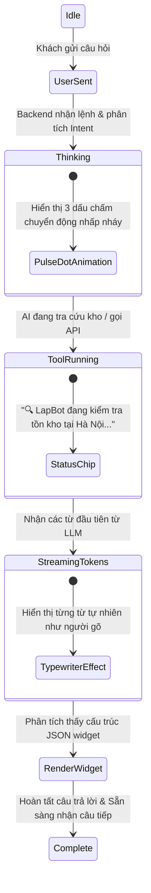

# ĐẶC TẢ GIAO DIỆN AI THỰC THI (GENERATIVE UI & INTERACTIVE WIDGETS)
## Thiết Kế Trải Nghiệm Chat-to-Order Trên Khung Giao Diện React - Dự Án LapBot

---

## 1. TRIẾT LÝ THIẾT KẾ GENERATIVE UI (CONVERSATIONAL + ACTIONABLE)

Khác với các chatbot truyền thống chỉ phản hồi văn bản thuần túy (plain text), **LapBot** áp dụng mô hình **Generative UI (Giao diện sinh theo ngữ cảnh)**:
1. **Trực quan hóa thông số kỹ thuật**: Laptop là mặt hàng công nghệ có nhiều chỉ số phức tạp; thay vì liệt kê 10 dòng chữ, AI sinh ra các **Spec Badge Cards** với biểu tượng trực quan (Chipset, RAM, Card màn hình, Cân nặng).
2. **Loại bỏ thao tác gõ thừa**: Khi AI hỏi khách muốn chọn cấu hình nào hoặc phương thức thanh toán gì, AI chủ động đính kèm các **Action Chips / Interactive Buttons** để khách hàng chỉ việc bấm 1 chạm.
3. **Thao tác chốt đơn khép kín (Self-contained Checkout)**: Khách hàng hoàn tất việc xác nhận sản phẩm, kiểm tra địa chỉ và quét mã QR chuyển khoản ngay trong lòng khung chat mà không bị chuyển hướng (redirect) làm đứt gãy mạch cảm xúc.

---

## 2. BỐ CỤC KHUNG CHAT TỔNG THỂ (CHAT CONTAINER ANATOMY)

Giao diện Chat của LapBot được thiết kế dạng **Floating Chat Drawer** linh hoạt ở góc dưới bên phải màn hình, có khả năng mở rộng (expand) thành cửa sổ bán nguyệt hoặc toàn màn hình trên thiết bị di động.

### 2.1. Wireframe bố cục tổng thể
```
+-------------------------------------------------------------+
| [O] LapBot AI Assistant - Tư vấn & Chốt đơn Laptop    [_] [X] |  <-- Header (Avatar, Trạng thái Online, Minimize/Close)
+-------------------------------------------------------------+
|                                                             |
|  [AI Avatar]                                                |
|  Chào bạn! Mình là LapBot. Bạn đang cần tìm laptop          |
|  cho nhu cầu học tập, đồ họa hay gaming tầm giá bao nhiêu?  |
|                                                             |
|  [Suggestions: "Gaming dưới 20tr"] ["Lập trình Mac/Win"]    |  <-- Quick Prompt Chips
|                                                             |
|  ---------------------------------------------------------  |
|                                                             |
|  [Khách hàng]                                              |
|  Tìm máy Dell hoặc Asus tầm 22 triệu để làm đồ họa 2D nhẹ    |
|                                                             |
|  [AI Avatar]                                                |
|  Dựa trên nhu cầu Adobe Photoshop/Illustrator và ngân sách,  |
|  mình gợi ý 2 mẫu có màn hình chuẩn màu 100% sRGB sau nhé:   |
|                                                             |
|  +-------------------------------------------------------+  |
|  | [GEN-UI]: LaptopSpecCard (Carousel / Comparison View)  |  |  <-- Generative UI Widget 1
|  +-------------------------------------------------------+  |
|                                                             |
|  +-------------------------------------------------------+  |
|  | [GEN-UI]: OrderPreviewCard (Xem trước đơn hàng)        |  |  <-- Generative UI Widget 2
|  +-------------------------------------------------------+  |
|                                                             |
+-------------------------------------------------------------+
| [Ghim giỏ hàng: 1 máy ASUS | 22.990.000đ] (Bấm xem nhanh)  |  <-- Mini Cart Anchor Bar (Sticky)
+-------------------------------------------------------------+
| [Nhập câu hỏi hoặc yêu cầu tư vấn...]              [Gửi/Mic]|  <-- Input Box + Attachments
+-------------------------------------------------------------+
```

---

## 3. CHI TIẾT CÁC THẺ GIAO DIỆN GENERATIVE UI (COMPONENT CATALOG)

Mỗi component dưới đây tương ứng với một schema dữ liệu JSON mà AI Engine trả về thông qua cơ chế Function Calling / SSE Events.

### 3.1. Thẻ Thông Số Laptop (LaptopSpecCard)
- **Mục đích**: Hiển thị thông số máy tính trực quan, làm nổi bật điểm mạnh phù hợp với nhu cầu khách hàng vừa nêu.
- **Dữ liệu hiển thị**: Ảnh sản phẩm, Tên thương hiệu, Tên model, Giá niêm yết & Giá khuyến mãi, Bộ thông số kỹ thuật chính (CPU, RAM, Ổ cứng, GPU, Màn hình, Khối lượng).
- **Hành động người dùng (Actions)**:
  - Nút `[Xem chi tiết]`: Mở modal xem ảnh 360 và bài đánh giá chuyên sâu.
  - Nút `[Tùy chỉnh cấu hình]`: Mở bộ chọn nâng cấp RAM/SSD.
  - Nút `[Chọn mua máy này]`: Gửi tín hiệu vào luồng chat để AI bắt đầu quy trình tạo đơn.

```
+-------------------------------------------------------------+
| [Ảnh sản phẩm]   ASUS Vivobook 16X OLED (K3605VC)           |
|                  ⭐⭐⭐⭐⭐ (142 đánh giá) | Đã bán: 520+     |
|                  -----------------------------------------  |
|                  [ 22.990.000 đ ]  ~~25.490.000 đ~~ (-10%)  |
|                  [ Badge: Trả góp 0% ] [ Badge: Sẵn hàng ]  |
+-------------------------------------------------------------+
|  Thông số kỹ thuật chuẩn thiết kế:                          |
|  • CPU: Intel Core i5-13500H (12 nhân 16 luồng, cực khỏe)   |
|  • RAM: 16GB DDR4 (Hỗ trợ nâng lên 32GB)                    |
|  • Ổ cứng: 512GB SSD NVMe PCIe 4.0 siêu tốc                 |
|  • GPU: NVIDIA GeForce RTX 3050 4GB (Đồ họa mượt mà)        |
|  • Màn hình: 16.0" 3.2K OLED 120Hz, 100% DCI-P3 chuẩn màu   |
|  • Trọng lượng: 1.8 kg | Pin: 70Wh (Khoảng 6-7h văn phòng)   |
+-------------------------------------------------------------+
|  Quà tặng đi kèm:                                           |
|  🎁 Balo ASUS ROG + Chuột không dây Silent + Lót chuột size L|
+-------------------------------------------------------------+
|  [  Tùy chỉnh cấu hình  ]       [  👉 CHỌN MUA MÁY NÀY  ]   |
+-------------------------------------------------------------+
```

### 3.2. Bộ Tùy Biến Cấu Hình Nhanh (VariantCustomizerWidget)
- **Mục đích**: Cho phép khách hàng tự điều chỉnh dung lượng RAM, SSD hoặc Màu sắc máy tính ngay trong khung chat mà không cần chuyển trang.
- **Cơ chế tương tác**: Khi bấm chọn tùy chọn (ví dụ từ RAM 16GB sang 32GB), tổng giá của widget tự động nhảy thêm khoản chênh lệch (+1.200.000đ).

```
+-------------------------------------------------------------+
| ⚙️ TÙY BIẾN CẤU HÌNH: ASUS Vivobook 16X OLED                |
+-------------------------------------------------------------+
| Dung lượng RAM:                                             |
|   (o) 16GB (Có sẵn)             ( ) 32GB (+ 1.200.000 đ)    |
|                                                             |
| Dung lượng Ổ Cứng SSD:                                      |
|   (o) 512GB NVMe (Có sẵn)       ( ) 1TB NVMe (+ 950.000 đ)  |
|                                                             |
| Màu sắc vỏ máy:                                             |
|   [■ Bạc Ánh Sao]               [■ Đen Vũ Trụ] (Đang chọn)   |
+-------------------------------------------------------------+
| Tổng giá sau cấu hình:  24.190.000 đ                        |
| [ Hủy ]                         [ Áp dụng cấu hình này ]    |
+-------------------------------------------------------------+
```

### 3.3. Thẻ Tóm Tắt & Xem Trước Đơn Hàng (OrderPreviewCard)
- **Mục đích**: Đóng vai trò là hợp đồng giao dịch thu nhỏ giữa AI và khách hàng. Trực quan hóa toàn bộ thông tin đơn hàng trước khi chốt chính thức.
- **Các thành phần bảo đảm an toàn**:
  - Đồng hồ đếm ngược giữ chỗ kho (Countdown Timer): Hiển thị "Giữ kho trong 14:59".
  - Chi tiết người nhận: Họ tên, Số điện thoại, Địa chỉ giao hàng.
  - Nút bấm trực tiếp: `[XÁC NHẬN ĐẶT HÀNG]` (Màu xanh chủ đạo) và `[Sửa thông tin]` / `[Hủy bỏ]`.

```
+-------------------------------------------------------------+
| 🛒 XÁC NHẬN ĐƠN HÀNG #ORD-88219         ⏳ Giữ kho: 14:35    |
+-------------------------------------------------------------+
| Sản phẩm đặt mua:                                           |
| 1x ASUS Vivobook 16X OLED (Bản 32GB RAM / 512GB SSD)        |
|    Màu: Đen Vũ Trụ | Giá: 24.190.000 đ                      |
|                                                             |
| Thông tin giao hàng:                                        |
| 👤 Người nhận : Nguyễn Hoàng Tuấn                           |
| 📞 Điện thoại : 0988.776.655                                |
| 📍 Địa chỉ    : Số 45 Lê Văn Lương, Trung Hòa, Cầu Giấy, HN |
| 📝 Ghi chú    : Giao giờ hành chính, gọi trước 15 phút      |
+-------------------------------------------------------------+
| Bảng tính tiền:                                             |
| • Tiền hàng              : 24.190.000 đ                     |
| • Phí vận chuyển         : MIỄN PHÍ                         |
| • Khuyến mãi Voucher     : - 500.000 đ (SINHVIEN500K)       |
| ----------------------------------------------------------- |
| TỔNG THANH TOÁN          : 23.690.000 đ                     |
+-------------------------------------------------------------+
| Phương thức thanh toán:                                     |
|   ( ) COD - Trả tiền mặt khi nhận hàng                      |
|   (o) Chuyển khoản VietQR tức thời (Khuyên dùng - Nhanh gọn)|
+-------------------------------------------------------------+
| [ Sửa thông tin ]         [  👉 XÁC NHẬN ĐẶT HÀNG NGAY  ]   |
+-------------------------------------------------------------+
```

### 3.4. Thẻ Thanh Toán VietQR Tức Thời (VietQRCard)
- **Mục đích**: Hiển thị mã QR tiêu chuẩn Napas247 được sinh động theo giá trị và mã đơn hàng cụ thể.
- **Tính năng nổi bật**:
  - Quét bằng mọi ứng dụng ngân hàng hoặc ví điện tử tại Việt Nam.
  - Không cần nhập số tiền hay nội dung chuyển khoản thủ công (tránh nhầm lẫn dẫn đến treo đơn).
  - Trạng thái kiểm tra thanh toán tự động (Polling / WebSocket Listener) hiển thị thanh xoay (spinner) và tự động chuyển xanh ngay khi tài khoản nhận được tiền.

```
+-------------------------------------------------------------+
| 💳 THANH TOÁN ĐƠN HÀNG #ORD-88219 (VIETQR NAPAS 247)        |
+-------------------------------------------------------------+
|                  +-----------------------+                  |
|                  |   [ MÃ VIETQR ĐỘNG ]  |                  |
|                  |     Số tiền đúng:     |                  |
|                  |     23.690.000 đ      |                  |
|                  +-----------------------+                  |
|                                                             |
| Ngân hàng thụ hưởng : MB Bank (Ngân hàng Quân Đội)          |
| Số tài khoản        : 0988889999VIP                         |
| Tên tài khoản       : CTY CONG NGHE LAPBOT VIET NAM         |
| Số tiền             : 23.690.000 đ  [ Copy ]                |
| Nội dung CK         : LAPBOT ORD88219  [ Copy ]             |
+-------------------------------------------------------------+
| ⏳ Hạn thanh toán: 29:45 phút                               |
| 🔄 Hệ thống đang tự động kiểm tra giao dịch...               |
+-------------------------------------------------------------+
| [ Tải ảnh mã QR về máy ]     [ Đổi sang trả tiền mặt COD ]  |
+-------------------------------------------------------------+
```

### 3.5. Biểu Mẫu Nhập Địa Chỉ Nhanh (InlineAddressFormWidget)
- Khi khách hàng ngại gõ chữ trong câu chat hoặc AI nhận diện thông tin bị thiếu (ví dụ khách chỉ gõ SĐT mà chưa có địa chỉ), AI sẽ hiển thị biểu mẫu nhỏ gọn ngay trong dòng chat.
- Biểu mẫu có dropdown chọn Tỉnh/Thành -> Quận/Huyện -> Phường/Xã giúp chuẩn hóa địa chỉ bưu chính, tránh việc shipper giao nhầm.

---

## 4. CÁC TRẠNG THÁI PHẢN HỒI CỦA AI TRÊN GIAO DIỆN (AI RESPONSE LIFECYCLE)

Để tạo cảm giác chân thực và không gây khó chịu khi phải chờ đợi mô hình AI suy luận, hệ thống React hiển thị các trạng thái theo trình tự:



### 4.1. Thông báo trạng thái công cụ (Tool Execution Indicators)
Khi AI kích hoạt một tool dài hơn 500ms, khung chat hiển thị một thanh trạng thái mini sinh động:
- `🔍 Đang tra cứu kho máy tính và đối chiếu mức giá ưu đãi...`
- `📦 Đang giữ chỗ sản phẩm và khởi tạo đơn hàng...`
- `💳 Đang liên kết cổng ngân hàng tạo mã VietQR...`

Điều này giúp khách hàng hiểu rằng hệ thống đang thực sự tra cứu nghiệp vụ chứ không phải bị đứng máy (hang/freeze).

---

## 5. THIẾT KẾ ĐÁP ỨNG ĐA THIẾT BỊ (RESPONSIVE BEHAVIOR)

| Yếu tố giao diện | Màn hình Máy tính (Desktop / Laptop) | Màn hình Di động (Mobile Safari/Chrome) |
| :--- | :--- | :--- |
| **Kích thước khung chat** | Chiều rộng: 420px, Chiều cao: 650px. Cố định góc phải dưới, có nút mở rộng 600px. | Toàn màn hình (Full-screen Drawer 100vw x 100vh). Bàn phím ảo tự động đẩy khung chat lên. |
| **LaptopSpecCard** | Dạng danh sách so sánh nằm ngang hoặc Carousel với nút mũi tên trái/phải. | Dạng Carousel trượt vuốt bằng ngón tay (Horizontal swipe with snap-point). |
| **OrderPreviewCard** | Hiển thị 2 cột (Cột thông tin máy & Cột chi phí thanh toán). | Hiển thị 1 cột xếp chồng (Stacked layout). Nút xác nhận dính cố định dưới đáy màn hình (Sticky Bottom Button). |
| **Mã VietQR** | Kích thước 220x220px, có nút Copy nhanh số tài khoản và nội dung. | Kích thước 180x180px, có thêm nút "Mở ứng dụng Ngân hàng (Deep link App)". |
