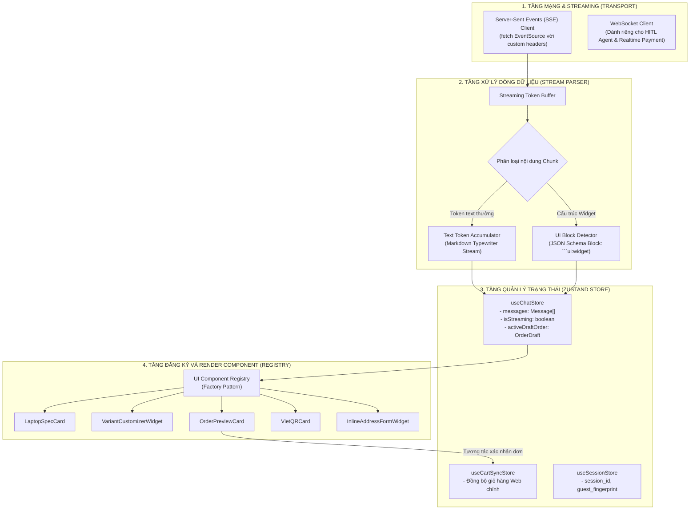
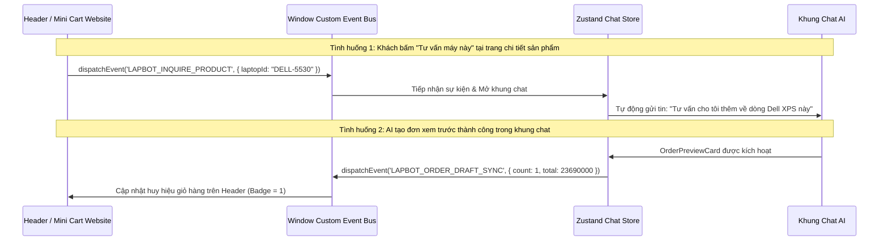

# TÀI LIỆU KỸ THUẬT AI PHÍA FRONTEND (REACT ARCHITECTURE)
## Kiến Trúc Triển Khai Generative UI & Quản Lý Trạng Thái Hội Thoại - Dự Án LapBot

---

## 1. TỔNG QUAN KIẾN TRÚC FRONTEND

Phía Frontend của LapBot được xây dựng trên nền tảng **React 18+**, áp dụng mô hình phân tách rõ ràng giữa **Tầng Kết Nối Truyền Nhận Stream (Transport Layer)**, **Tầng Phân Tích Cú Pháp Giao Diện Động (Streaming UI Parser)**, **Tầng Quản Lý Trạng Thái Cục Bộ (State Management)** và **Tầng Render Thành Phần Tương Tác (Component Registry)**.



---

## 2. QUẢN LÝ TRẠNG THÁI DỮ LIỆU (STATE MANAGEMENT VỚI ZUSTAND)

Thay vì sử dụng Redux cồng kềnh, LapBot ứng dụng **Zustand** để đạt hiệu năng cao, giảm re-render không cần thiết trong quá trình stream liên tục các token văn bản.

### 2.1. Cấu trúc mô hình dữ liệu (Data Models)

#### Kiểu dữ liệu tin nhắn (Message Model)
```typescript
interface ChatMessage {
  id: string;                      // UUID duy nhất cho từng tin nhắn
  sender: 'user' | 'assistant' | 'agent' | 'system';
  content: string;                 // Nội dung văn bản Markdown
  timestamp: number;
  status: 'sending' | 'streaming' | 'completed' | 'error';
  widget?: {
    type: 'laptop_spec' | 'variant_customizer' | 'order_preview' | 'vietqr_payment' | 'address_form';
    data: Record<string, any>;     // Dữ liệu payload của widget
    isActionCompleted?: boolean;   // Đánh dấu người dùng đã ấn xác nhận hay chưa
  };
  suggestedActions?: string[];     // Các chip gợi ý câu hỏi tiếp theo
}
```

#### Kiểu dữ liệu giỏ hàng tạm & Đơn hàng trong Chat
```typescript
interface ActiveDraftOrder {
  orderId: string;
  items: Array<{
    laptopId: string;
    modelName: string;
    ram: string;
    ssd: string;
    color: string;
    unitPrice: number;
    quantity: number;
    thumbnailUrl: string;
  }>;
  customerInfo: {
    fullName: string;
    phone: string;
    address: string;
    note?: string;
  };
  pricing: {
    subtotal: number;
    shippingFee: number;
    discountAmount: number;
    finalTotal: number;
  };
  paymentMethod: 'COD' | 'VIETQR';
  lockExpiresAt: number;           // Unix timestamp hết hạn soft-lock (15 phút)
  qrData?: {
    qrImageUrl: string;
    accountNumber: string;
    bankCode: string;
    transferContent: string;
  };
}
```

---

## 3. CƠ CHẾ STREAMING VÀ PHÂN GIẢI GENERATIVE UI (STREAM PARSER)

### 3.1. Thách thức kỹ thuật
Khi gọi LLM API qua Server-Sent Events (SSE), phản hồi trả về là một chuỗi văn bản liên tục (streaming tokens). Chuỗi này có thể chứa cả văn bản giải thích thông thường VÀ các khối dữ liệu JSON mô tả widget giao diện. Nếu hiển thị JSON thô, người dùng sẽ thấy rối mắt; ngược lại nếu đợi hết câu trả lời mới parse thì mất đi trải nghiệm thời gian thực.

### 3.2. Giải pháp giao thức đóng gói (Wire Protocol Format)
Backend và AI Gateway trả về luồng dữ liệu tuân theo chuẩn phân định đặc biệt:
```text
data: {"type": "text_delta", "content": "Dạ, em đã tìm thấy 2 mẫu laptop phù hợp nhất với anh:"}
data: {"type": "text_delta", "content": "\n\n"}
data: {"type": "ui_widget_start", "widget_type": "laptop_spec"}
data: {"type": "ui_widget_chunk", "chunk": "{\"laptops\":[{\"id\":\"L-01\",\"name\":\"ASUS Vivobook 16X\""}
data: {"type": "ui_widget_chunk", "chunk": ",\"price\":22990000,\"ram\":\"16GB\",\"cpu\":\"i5-13500H\"}]}"}
data: {"type": "ui_widget_end"}
data: {"type": "text_delta", "content": "\nAnh xem thử 2 cấu hình trên có ưng ý không nhé!"}
```

### 3.3. Thuật toán xử lý trên Frontend
1. **Trạng thái Stream**: Client duy trì máy trạng thái mini gồm 2 mode: `MODE_TEXT` và `MODE_WIDGET_BUFFER`.
2. Khi bắt gặp `ui_widget_start`, parser không render văn bản lên màn hình mà gom dữ liệu chunk vào một bộ đệm tạm thời (accumulator string).
3. Trong lúc đang gom widget, trên giao diện hiển thị ngay lập tức một **Skeleton Widget / Loading Card Shimmer** để người dùng biết có thẻ sắp xuất hiện.
4. Khi nhận `ui_widget_end`, hệ thống thực hiện `JSON.parse()`, kiểm tra schema dữ liệu và hoán đổi từ Skeleton sang Component thực thụ (`LaptopSpecCard`).

---

## 4. BỘ ĐĂNG KÝ VÀ RENDER COMPONENT ĐỘNG (COMPONENT REGISTRY)

Áp dụng mẫu thiết kế **Factory Pattern** và **Dynamic Component Registry** để tách biệt logic hiển thị giao diện khỏi luồng xử lý dữ liệu:

```typescript
// Bảng ánh xạ từ mã định danh AI sang React Component
const UI_COMPONENT_MAP: Record<string, React.ComponentType<any>> = {
  'laptop_spec': LaptopSpecCard,
  'variant_customizer': VariantCustomizerWidget,
  'order_preview': OrderPreviewCard,
  'vietqr_payment': VietQRCard,
  'address_form': InlineAddressFormWidget,
};

// Component bao đóng chịu trách nhiệm render động
export const GenerativeUIResolver: React.FC<{ widget: ChatWidgetData }> = ({ widget }) => {
  const TargetComponent = UI_COMPONENT_MAP[widget.type];
  
  if (!TargetComponent) {
    // Fallback an toàn nếu AI sinh loại widget không tồn tại
    return null;
  }
  
  return (
    <div className="my-3 transition-all duration-300 animate-fadeIn">
      <TargetComponent data={widget.data} isCompleted={widget.isActionCompleted} />
    </div>
  );
};
```

---

## 5. TƯƠNG TÁC HAI CHIỀU GIỮA KHUNG CHAT VÀ TOÀN BỘ WEBSITE (EVENT BUS)

Khung chat không phải là một "ốc đảo" cô lập. Hành động trong chat tác động tới website chính và ngược lại:



---

## 6. KHẢ NĂNG CHỊU LỖI, BỘ NHỚ CỤC BỘ VÀ TỐI ƯU TRẢI NGHIỆM MẠNG

### 6.1. Lưu trữ phiên và khôi phục khi F5 (Session Persistence)
- Sử dụng `localStorage` lưu trữ:
  - `lapbot_session_id`: UUID phiên chat (hết hạn sau 24h không hoạt động).
  - `lapbot_guest_token`: Định danh khách vãng lai để nhận diện lịch sử chat cũ.
  - `lapbot_cached_messages`: Tối đa 20 tin nhắn gần nhất để hiển thị ngay tức thì trước khi đồng bộ máy chủ hoàn tất.

### 6.2. Cơ chế xử lý mất kết nối & Reconnect Exponential Backoff
- Khi đường truyền mạng bị đứt trong lúc AI đang stream:
  1. Client giữ nguyên đoạn text đã nhận đến thời điểm đó.
  2. Hiển thị thông báo nhỏ: *"Kết nối gián đoạn, đang tự động kết nối lại..."*
  3. Thử kết nối lại theo chu kỳ lũy thừa: 1s -> 2s -> 4s -> tối đa 10s.
  4. Nếu sau 3 lần không thành công, hiển thị nút `[Thử gửi lại]`.

### 6.3. Giám sát trạng thái thanh toán VietQR (Smart Polling)
- Khi thẻ `VietQRCard` được hiển thị, Frontend kích hoạt cơ chế kiểm tra trạng thái thanh toán:
  - **Kênh chính**: Lắng nghe WebSocket event `ORDER_PAYMENT_SUCCESS`.
  - **Kênh dự phòng (Fallback)**: Polling REST API `GET /api/orders/{id}/payment-status` mỗi 3 giây trong vòng 10 phút.
  - Khi nhận được tín hiệu thành công, thẻ tự động kích hoạt hiệu ứng chúc mừng (Confetti animation) và chuyển trạng thái đơn hàng sang đã thanh toán.
