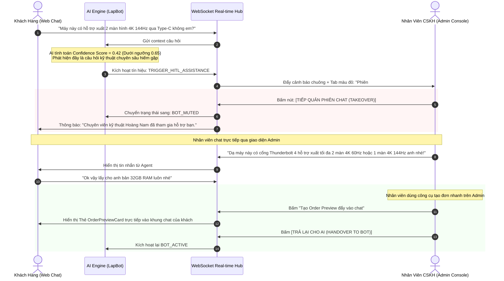
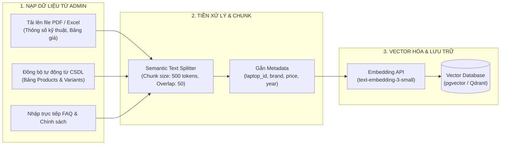

# TÀI LIỆU KỸ THUẬT AI PHÍA ADMIN (MANAGEMENT & HITL ARCHITECTURE)
## Hệ Thống Giám Sát Hội Thoại, Can Thiệp Con Người (HITL) & Quản Trị Tri Thức RAG - Dự Án LapBot

---

## 1. MỤC TIÊU VÀ VAI TRÒ CỦA HỆ THỐNG ADMIN AI

Cổng quản trị AI (Admin AI Console) không chỉ đơn thuần là nơi cấu hình hệ thống, mà đóng vai trò là **Trung tâm chỉ huy vận hành bán hàng thông minh (AI Command Center)** với 4 trụ cột kỹ thuật:
1. **Giám sát thời gian thực (Live Stream Monitoring)**: Theo dõi trực tiếp các phiên chat đang diễn ra giữa khách hàng và AI.
2. **Cơ chế can thiệp con người (Human-in-the-Loop - HITL)**: Cảnh báo nguy cơ khách hàng bỏ đi, cho phép nhân viên tư vấn nhảy vào cuộc trò chuyện tức thì để cứu vãn đơn hàng.
3. **Quản trị cơ sở tri thức RAG (Knowledge Base Management)**: Cập nhật thông số kỹ thuật laptop mới, chính sách bảo hành, chương trình khuyến mại dạng tài liệu và tự động vector hóa (Embeddings).
4. **Phân tích hiệu quả kinh doanh của AI (AI Sales Analytics)**: Đo lường chính xác tỷ lệ chuyển đổi từ hội thoại thành đơn hàng thực tế.

---

## 2. KIẾN TRÚC CAN THIỆP CON NGƯỜI (HUMAN-IN-THE-LOOP - HITL)

### 2.1. Sơ đồ cơ chế hoạt động HITL



### 2.2. Giao thức chuyển giao trạng thái (State Transition Protocol)
Một phiên chat tại máy chủ luôn mang một trong 3 trạng thái kiểm soát:
- `MODE_AI_AUTONOMOUS`: AI tự động trả lời 100%. Mọi tin nhắn của khách do LLM xử lý.
- `MODE_AGENT_TAKEOVER`: Nhân viên con người đang trực tiếp chat. Toàn bộ phản hồi tự động của LLM bị khóa (Mute). AI chỉ hoạt động ở chế độ ngầm đóng vai trò "Co-pilot" gợi ý câu trả lời cho nhân viên.
- `MODE_HYBRID_SUPERVISED`: AI trả lời nhưng câu trả lời cần nhân viên bấm nút "Duyệt" trên màn hình Admin trước khi đẩy tới khách hàng (áp dụng cho các đơn hàng giá trị cao trên 50 triệu đồng).

---

## 3. THIẾT KẾ BÀN LÀM VIỆC ADMIN HITL (OPERATOR CONSOLE)

Bố cục giao diện làm việc của nhân viên CSKH / Admin được tối ưu hóa theo mô hình 3 cột để thao tác nhanh:

```
+----------------------------------------------------------------------------------------------------+
| LAPBOT COMMAND CENTER - GIÁM SÁT & TIẾP QUẢN HỘI THOẠI                    [Admin: Nguyen Van A] [🔔 3]|
+--------------------------+------------------------------------------+------------------------------+
| CỘT 1: DANH SÁCH PHIÊN   | CỘT 2: KHUNG CHAT TRỰC TIẾP (LIVE CHAT)  | CỘT 3: THÔNG TIN & CÔNG CỤ   |
| (Lọc: Khẩn cấp / Đang chat)|                                          | (NGHIỆP VỤ ĐƠN HÀNG)        |
+--------------------------+------------------------------------------+------------------------------+
| [🔴 CẦN HỖ TRỢ (2)]       | Phiên: #S-8821 - Khách: Nguyễn Tuấn     | Khách hàng: Nguyễn Tuấn      |
| • #S-8821 (Tuấn - 0988..) | Thiết bị: Windows Chrome | IP: Hà Nội     | SĐT: 0988.776.655            |
|   Lý do: Hỏi xuất màn hình| [ Nút: TIẾP QUẢN CHAT ] [ Gợi ý Copilot ]| Lịch sử: 2 đơn cũ            |
|   Thời gian chờ: 15s     | ---------------------------------------- | ---------------------------- |
|                          | [10:14] Khách: Cần máy đồ họa 2D nhẹ     | Máy đang quan tâm:           |
| • #S-8819 (Mai - 0912..) | [10:14] Bot: Đã gợi ý ASUS Vivobook 16X  | • ASUS Vivobook 16X OLED     |
|   Lý do: Phân vân giá    | [10:15] Khách: Cổng Type-C có xuất được  |   Giá: 22.990.000 đ          |
|                          |         2 màn 4K 144Hz không em?         |   Kho: Còn 4 chiếc           |
| [🟢 BOT ĐANG TỰ XỬ LÝ (8)]| [10:15] ⚠️ Bot Confidence Thấp (42%)     | ---------------------------- |
| • #S-8825 (Minh)         | ---------------------------------------- | Công cụ đẩy nhanh vào chat:  |
| • #S-8830 (Hoàng)        | [Soạn tin nhắn tiếp quản hoặc chọn mẫu]  | [➕ Gửi Voucher giảm 500K]   |
|                          | [ Gợi ý AI: "Dạ cổng Thunderbolt 4 có.." ]| [📦 Đẩy Thẻ Đơn Hàng Draft]  |
| [🟡 CHỜ XÁC NHẬN ĐƠN (3)]| [ Nút: Gửi tin nhắn ]                   | [💳 Sinh mã VietQR thủ công] |
+--------------------------+------------------------------------------+------------------------------+
```

---

## 4. QUẢN TRỊ CƠ SỞ TRI THỨC RAG (KNOWLEDGE BASE & VECTOR PIPELINE)

Để AI nắm bắt được thông số của hàng trăm mẫu laptop mới nhập kho và các chính sách bảo hành thay đổi liên tục, hệ thống Admin cung cấp module quản trị RAG Ingestion Pipeline:



### 4.1. Quy chuẩn cập nhật và kiểm thử tri thức (RAG Playground)
- Admin được cung cấp tính năng **Test Playground**: Nhập câu hỏi thử nghiệm (Ví dụ: *"Chính sách bảo hành màn hình OLED bị sọc"*), hệ thống sẽ hiển thị:
  - 3 đoạn tài liệu (chunks) được Vector Search truy xuất nhiều nhất kèm điểm tương đồng cosine similarity (Cosine Score).
  - Câu trả lời mẫu mà AI dự kiến sẽ trả lời khách hàng.
  - Cho phép người quản trị bấm `[Cập nhật lại Embedding]` chỉ trong 1 thao tác nếu phát hiện thông tin lỗi thời.

---

## 5. QUẢN LÝ PHIÊN BẢN PROMPT & A/B TESTING (PROMPT GOVERNANCE)

Hệ thống cho phép Tech Lead / Product Manager tinh chỉnh System Prompt mà không cần build hoặc restart lại backend:
1. **Lưu vết phiên bản (Prompt Versioning)**: Mỗi lần sửa System Prompt sẽ tạo ra phiên bản mới (`v1.0.1`, `v1.0.2`...).
2. **A/B Testing Luồng Chốt Đơn**:
   - Nhánh A (50% khách hàng): Áp dụng Prompt phong cách tư vấn tận tình, đào sâu kỹ thuật rồi mới gợi ý chốt đơn.
   - Nhánh B (50% khách hàng): Áp dụng Prompt phong cách hành động nhanh (Action-oriented), sớm hiển thị thẻ cấu hình và khuyến mãi để kích thích mua nhanh.
3. **Chỉ số so sánh (A/B Metrics)**: Đo lường trực tiếp Doanh thu bình quân trên mỗi cuộc chat và Tỷ lệ hoàn thành đơn giữa 2 nhánh.

---

## 6. HỆ THỐNG ĐO LƯỜNG & PHÂN TÍCH CHUYỂN ĐỔI (ANALYTICS & CONVERSION FUNNEL)

Bảng điều khiển báo cáo đo lường phễu chuyển đổi chuyên biệt cho hình thức Chat-to-Order:

```
[ TOÀN BỘ PHIÊN CHAT KHỞI TẠO: 10.000 ] (100%)
       │
       ▼
[ PHIÊN CÓ XEM THẺ LAPTOP SPEC CARD: 6.800 ] (68.0%)
       │
       ▼
[ PHIÊN TÙY CHỈNH CẤU HÌNH / THÊM GIỎ: 3.400 ] (34.0%)
       │
       ▼
[ PHIÊN SINH THẺ ORDER PREVIEW: 1.850 ] (18.5%)
       │
       ▼
[ ĐƠN HÀNG XÁC NHẬN THÀNH CÔNG: 1.220 ] (12.2%)  <-- Tỷ lệ chốt đơn (Conversion Rate)
       ├─ Thanh toán COD    : 780 đơn (63.9%)
       └─ Thanh toán VietQR : 440 đơn (36.1%)
```

### 6.1. Các chỉ số hiệu năng AI (AI Performance KPIs)
- **Tỷ lệ tự động hóa thành công (Autonomous Resolution Rate)**: Tỷ lệ các phiên chốt đơn hoặc giải đáp thành công mà không cần con người can thiệp (Mục tiêu: >= 75%).
- **Tỷ lệ kích hoạt Human-Takeover (Escalation Rate)**: Tỷ lệ khách hàng phải chuyển giao cho nhân viên (Mục tiêu: <= 25%).
- **Thời gian trung bình sinh đơn (Average Time to Order)**: Thời gian từ tin nhắn đầu tiên đến khi đơn hàng tạo thành công (Mục tiêu: <= 180 giây).
- **Điểm đánh giá trải nghiệm (CSAT Rating)**: Tỷ lệ khách hàng đánh giá 5 sao sau khi kết thúc cuộc trò chuyện (Mục tiêu: >= 4.7/5).
