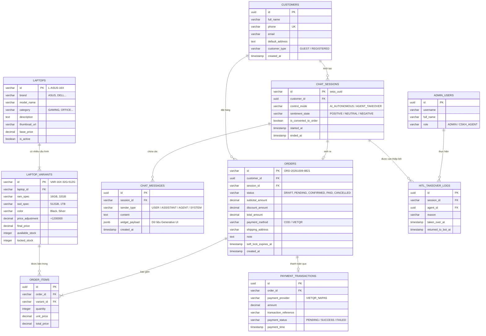

# ĐẶC TẢ HỢP ĐỒNG API ML VÀ CƠ SỞ DỮ LIỆU
## Chi Tiết Kỹ Thuật Giao Tiếp Hệ Thống & Thiết Kế Lược Đồ Dữ Liệu - Dự Án LapBot

---

## 1. ĐẶC TẢ GIAO DIỆN LẬP TRÌNH ỨNG DỤNG (API SPECIFICATIONS)

Toàn bộ các giao tiếp giữa React Client, Hệ thống Backend và AI Gateway được chuẩn hóa qua chuẩn RESTful kết hợp Server-Sent Events (SSE) và WebSocket.

### 1.1. Danh mục các điểm cuối (Endpoints Matrix)

| Phương thức | Đường dẫn Endpoint | Mục đích kỹ thuật | Định dạng truyền tải |
| :--- | :--- | :--- | :--- |
| `POST` | `/api/v1/chat/session` | Khởi tạo phiên chat mới hoặc khôi phục phiên cũ. | JSON |
| `POST` | `/api/v1/chat/message-stream` | Gửi tin nhắn từ người dùng và nhận stream phản hồi từ AI. | `text/event-stream` (SSE) |
| `POST` | `/api/v1/chat/widget-action` | Xử lý sự kiện khi người dùng bấm nút trên Generative UI widget. | JSON |
| `GET` | `/api/v1/orders/{orderId}/status` | Kiểm tra trạng thái đơn hàng & kết quả thanh toán VietQR. | JSON / Polling |
| `WS` | `/ws/v1/admin/hitl` | Kênh WebSocket truyền nhận tin nhắn giám sát và tiếp quản chat. | WebSocket Frames |

---

### 1.2. Chi tiết hợp đồng Endpoint quan trọng

#### Endpoint 1: Khởi tạo phiên làm việc (`POST /api/v1/chat/session`)
- **Headers**: `Authorization: Bearer <token>` (tùy chọn nếu đã đăng nhập), `X-Guest-Fingerprint: <uuid>`
- **Request Body**:
```json
{
  "guest_fingerprint": "fp_88291a_chrome_win",
  "referrer_url": "https://lapbot.vn/san-pham/asus-vivobook-16x",
  "initial_context": {
    "current_product_id": "L-ASUS-16X",
    "utm_source": "google_ads"
  }
}
```
- **Response (200 OK)**:
```json
{
  "session_id": "sess_99a8b1c2-3d4e-5f6a",
  "is_returning_customer": true,
  "customer_name": "Nguyễn Tuấn",
  "last_draft_order_id": null,
  "greeting_message": "Chào anh Tuấn! Rất vui được gặp lại anh. Anh đang quan tâm dòng ASUS Vivobook 16X đúng không ạ?"
}
```

#### Endpoint 2: Gửi tin nhắn & Streaming AI (`POST /api/v1/chat/message-stream`)
- **Headers**: `Content-Type: application/json`, `Accept: text/event-stream`
- **Request Body**:
```json
{
  "session_id": "sess_99a8b1c2-3d4e-5f6a",
  "message": "Anh muốn lấy bản này nâng lên 32GB RAM, giao về Cầu Giấy Hà Nội thì bao nhiêu tiền em?"
}
```
- **Phản hồi Server-Sent Events (SSE Chunks)**:
```text
event: text_delta
data: {"text": "Dạ vâng anh Tuấn! Bản nâng cấp lên "}

event: text_delta
data: {"text": "32GB RAM sẽ có giá 24.190.000đ (đã bao gồm phí lắp đặt và bảo hành chính hãng)."}

event: widget
data: {"widget_type": "order_preview", "payload": {"draft_id": "ORD-DRAFT-9182", "product_name": "ASUS Vivobook 16X OLED", "ram": "32GB", "ssd": "512GB", "final_price": 24190000, "shipping_fee": 0, "soft_lock_expires_in": 900}}

event: done
data: {"tokens_used": 342, "processing_time_ms": 780}
```

---

## 2. ĐẶC TẢ CÔNG CỤ FUNCTION CALLING DÀNH CHO AI (TOOLS SCHEMA)

Mô hình LLM (OpenAI GPT-4o / Gemini 1.5 Pro) được trang bị bộ công cụ có cấu trúc định sẵn (Structured Tools) để tương tác trực tiếp với cơ sở dữ liệu nghiệp vụ:

### 2.1. Tool 1: `search_laptop_catalog`
- **Mục đích**: Tìm kiếm máy tính xách tay theo tiêu chí ngân sách, cấu hình và nhu cầu sử dụng thực tế.
```json
{
  "name": "search_laptop_catalog",
  "description": "Tra cứu danh mục laptop theo nhu cầu kỹ thuật, khoảng giá và thương hiệu từ kho hàng.",
  "parameters": {
    "type": "object",
    "properties": {
      "usage_category": {
        "type": "string",
        "enum": ["office_study", "gaming", "graphic_creator", "programming", "business_ultrabook"],
        "description": "Nhu cầu sử dụng chính của khách hàng"
      },
      "min_price": { "type": "number", "description": "Giá tối thiểu (VNĐ)" },
      "max_price": { "type": "number", "description": "Giá tối đa ngân sách (VNĐ)" },
      "preferred_brand": {
        "type": "string",
        "enum": ["ASUS", "DELL", "HP", "LENOVO", "APPLE", "ACER", "MSI", "ANY"],
        "description": "Thương hiệu yêu thích"
      },
      "min_ram_gb": { "type": "integer", "description": "Dung lượng RAM tối thiểu (GB)" }
    },
    "required": ["usage_category", "max_price"]
  }
}
```

### 2.2. Tool 2: `create_draft_order`
- **Mục đích**: Khởi tạo đơn hàng nháp, kích hoạt soft-lock tồn kho và sinh thẻ xem trước đơn hàng.
```json
{
  "name": "create_draft_order",
  "description": "Tạo đơn hàng nháp trong hệ thống khi đã có thông tin cấu hình máy và khách hàng cơ bản.",
  "parameters": {
    "type": "object",
    "properties": {
      "laptop_id": { "type": "string", "description": "Mã sản phẩm chính" },
      "variant_id": { "type": "string", "description": "Mã cấu hình biến thể (RAM/SSD)" },
      "quantity": { "type": "integer", "default": 1 },
      "customer_name": { "type": "string", "description": "Họ và tên người nhận hàng" },
      "customer_phone": { "type": "string", "description": "Số điện thoại di động (10 chữ số)" },
      "shipping_address": { "type": "string", "description": "Địa chỉ nhận hàng chi tiết" },
      "voucher_code": { "type": "string", "description": "Mã giảm giá (nếu có)" },
      "payment_method": {
        "type": "string",
        "enum": ["COD", "VIETQR"],
        "description": "Phương thức thanh toán lựa chọn"
      }
    },
    "required": ["laptop_id", "customer_name", "customer_phone", "shipping_address", "payment_method"]
  }
}
```

### 2.3. Tool 3: `escalate_to_human_agent`
- **Mục đích**: Báo động hệ thống chuyển phiên chat cho nhân viên CSKH khi phát hiện tình huống vượt ngoài khả năng giải quyết hoặc khách yêu cầu.
```json
{
  "name": "escalate_to_human_agent",
  "description": "Chuyển giao quyền trò chuyện cho nhân viên con người (Human-in-the-loop).",
  "parameters": {
    "type": "object",
    "properties": {
      "reason": {
        "type": "string",
        "enum": ["customer_requested", "low_confidence_technical", "pricing_negotiation", "negative_sentiment"],
        "description": "Lý do kích hoạt can thiệp"
      },
      "urgency_level": {
        "type": "string",
        "enum": ["low", "medium", "critical"]
      },
      "summary_context": {
        "type": "string",
        "description": "Tóm tắt ngắn gọn vấn đề đang thảo luận để nhân viên nắm bắt nhanh"
      }
    },
    "required": ["reason", "urgency_level", "summary_context"]
  }
}
```

---

## 3. THIẾT KẾ CƠ SỞ DỮ LIỆU QUAN HỆ (RELATIONAL DATABASE ERD)

Toàn bộ hệ thống quản lý dữ liệu sản phẩm, giỏ hàng, đơn hàng và lịch sử phiên chat được thiết kế theo chuẩn cơ sở dữ liệu quan hệ (PostgreSQL / MySQL) với độ toàn vẹn tham chiếu cao:



---

## 4. CHI TIẾT TỪ ĐIỂN DỮ LIỆU (DATA DICTIONARY CỐT LÕI)

### 4.1. Bảng `orders` (Quản lý Đơn hàng)
- `id` (VARCHAR(36), PK): Mã đơn hàng có định dạng chuẩn dễ đọc cho khách (VD: `ORD-20261009-8821`).
- `session_id` (VARCHAR(64), FK, Nullable): Khóa ngoại liên kết tới phiên chat sinh ra đơn hàng này. Dùng để truy vết tỷ lệ chuyển đổi.
- `status` (VARCHAR(30)): Trạng thái đơn tuân thủ Finite State Machine (`DRAFT`, `PENDING_CONFIRMATION`, `AWAITING_PAYMENT_QR`, `CONFIRMED_COD`, `PAID`, `PROCESSING`, `SHIPPING`, `COMPLETED`, `CANCELLED`, `EXPIRED`).
- `soft_lock_expires_at` (TIMESTAMP): Thời điểm hết hạn giữ kho 15 phút.
- `payment_method` (VARCHAR(20)): `COD` hoặc `VIETQR`.

### 4.2. Bảng `laptop_variants` (Cấu hình và Tồn kho phân mảnh)
- `id` (VARCHAR(64), PK): Mã định danh duy nhất của cấu hình máy (VD: `VAR-VIVO-16X-32-1TB-BLK`).
- `available_stock` (INT, NOT NULL): Số lượng thực tế có thể bán cho khách mới.
- `locked_stock` (INT, DEFAULT 0): Số lượng đang được giữ trong các đơn hàng nháp `PENDING_CONFIRMATION`.
- `final_price` (DECIMAL(12, 2)): Mức giá bán cuối cùng của biến thể này.

### 4.3. Bảng `chat_messages` (Lưu vết hội thoại và Generative UI)
- `widget_payload` (JSONB): Chứa cấu trúc đặc tả thành phần giao diện động được AI sinh ra để Frontend phục hồi lại chính xác trạng thái giao diện khi tải lại trang hoặc mở lịch sử đơn hàng.
